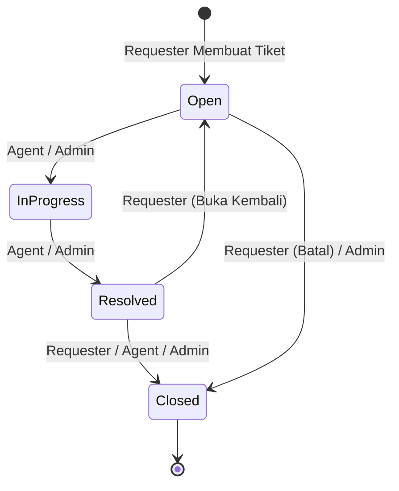

# Helpdesk Application (Fullstack)

Aplikasi helpdesk internal lengkap yang dibangun untuk menggantikan alur email dan spreadsheet dalam menangani permintaan bantuan karyawan. Dibangun secara mandiri dari nol (*from scratch*) menggunakan **Go 1.22+** (`net/http` standard library), **Vue 3** (Composition API `<script setup>`), **PostgreSQL**, dan **Docker Compose**.

---

## Daftar Isi
- [Struktur Monorepo](#struktur-monorepo)
- [Akun Bawaan (Seed Data)](#akun-bawaan-seed-data)
- [Panduan Menjalankan Aplikasi](#panduan-menjalankan-aplikasi)
- [Daftar Endpoint REST API](#daftar-endpoint-rest-api)
- [Matriks Alur Transisi Status Tiket](#matriks-alur-transisi-status-tiket)
- [Dokumentasi API (OpenAPI & Postman)](#dokumentasi-api-openapi--postman)
- [Cara Menjalankan Automated Tests](#cara-menjalankan-automated-tests)
- [Asumsi Teknis & Penafsiran Spesifikasi](#asumsi-teknis--penafsiran-spesifikasi)
- [Keputusan Arsitektur & Catatan](#keputusan-arsitektur--catatan)

---

## Struktur Monorepo

```text
.
├── backend/                       # Backend Go 1.22+
│   ├── cmd/server/                # Entrypoint server (main.go)
│   ├── internal/
│   │   ├── auth/                  # Hashing bcrypt & JWT service (HS256)
│   │   ├── config/                # Environment variable loader
│   │   ├── database/              # Koneksi PostgreSQL & embedded migration runner
│   │   ├── handler/               # HTTP Controller/Handler
│   │   ├── middleware/            # JWT Auth extractor, context injector & RBAC
│   │   ├── model/                 # Entity structs & status transition validator
│   │   └── repository/            # Database queries (database/sql + raw SQL)
│   ├── migrations/                # Berkas SQL migration (.up.sql & .down.sql) & embed.go
│   ├── Dockerfile                 # Multi-stage Docker build untuk Go backend
│   ├── go.mod                     # Go module descriptor
│   └── go.sum                     # Go checksums
├── frontend/                      # Frontend Vue 3 (Vite + Tailwind CSS + Pinia)
│   ├── src/
│   │   ├── api/                   # Centralized Axios client & 401 interceptor
│   │   ├── components/            # UI components (Badge, Spinner, Empty state, dll)
│   │   ├── router/                # Vue Router & Navigation Guards
│   │   ├── stores/                # Pinia Auth Store & session persistence
│   │   └── views/                 # Halaman utama (Login, Register, Tickets, Detail, Admin)
│   ├── Dockerfile                 # Multi-stage Docker build (Node.js 22 + Nginx Alpine)
│   └── nginx.conf                 # Nginx reverse proxy & SPA HTML5 routing fallback
├── docs/                          # Dokumentasi Teknis
│   ├── openapi.yaml               # Spesifikasi resmi OpenAPI 3.0 (Swagger)
│   ├── Helpdesk_API.postman_collection.json # Koleksi Postman siap pakai
│   └── SPEC_TRACKER.md            # Dokumentasi pelacak fase & panduan wawancara
├── docker-compose.yml             # Orkestrasi 3 service: db, backend, frontend
├── .env.example                   # Contoh konfigurasi environment variable
├── NOTES.md                       # Catatan arsitektur & trade-offs (sesuai instruksi PDF)
└── README.md                      # Dokumentasi utama proyek
```

---

## Akun Bawaan (Seed Data)

Database secara otomatis melakukan migrasi skema dan mengisi data akun awal (*seed*) saat sistem pertama kali dijalankan. Seluruh kata sandi di-hash menggunakan algoritma **bcrypt** (cost 10):

| Peran (Role) | Nama | Alamat Email | Password | Hak Akses Utama |
|---|---|---|---|---|
| **Admin** | System Admin | `admin@example.com` | `Password123!` | Semua hak agent + kelola pengguna & ubah peran |
| **Agent** | Support Agent | `agent@example.com` | `Password123!` | Melihat semua tiket, ambil tiket, ubah status/prioritas, komentar & catatan internal |
| **Requester** | Requester User | `requester@example.com` | `Password123!` | Membuat tiket, melihat & komentar hanya pada tiket miliknya, membatalkan/menutup tiket sendiri |

> **Fitur Uji Coba Cepat:** Pada halaman login (`http://localhost:3000/login`), terdapat tombol cepat satu-klik untuk mengisi otomatis kredensial masing-masing role di atas guna mempermudah reviewer mencoba aplikasi.

---

## Panduan Menjalankan Aplikasi

Aplikasi dirancang agar dapat dijalankan dengan **satu perintah** menggunakan Docker Desktop.

### 1. Salin Konfigurasi Environment
```bash
cp .env.example .env
```
*(Di Windows PowerShell: `Copy-Item .env.example .env`)*

### 2. Jalankan Seluruh Sistem
```bash
docker compose up -d --build
```

Setelah perintah selesai dijalankan, ketiga container akan otomatis aktif:
- **Frontend & Web UI**: Buka peramban di [http://localhost:3000](http://localhost:3000)
- **API Health Check**: [http://localhost:3000/api/health](http://localhost:3000/api/health)
- **Direct Backend Port**: `http://localhost:8081` *(sesuai PORT di .env)*
- **PostgreSQL Database**: Port `5432`

### 3. Menghentikan Aplikasi
```bash
docker compose down
```

---

## Daftar Endpoint REST API

Seluruh endpoint REST API menggunakan format JSON seragam dan dilindungi JWT Bearer Authentication (kecuali endpoint publik):

| Method | Path | Fungsi | Hak Akses (RBAC) |
|---|---|---|---|
| `GET` | `/api/health` | Health check ketersediaan backend & database | Publik |
| `POST` | `/api/auth/register` | Mendaftar akun karyawan baru (default role: requester) | Publik |
| `POST` | `/api/auth/login` | Login akun, verifikasi bcrypt, mengembalikan token JWT | Publik |
| `GET` | `/api/me` | Mengambil profil user yang sedang aktif | Authenticated (Semua role) |
| `GET` | `/api/tickets` | Mengambil daftar tiket (filter, search, pagination) | Authenticated (Requester dibatasi miliknya) |
| `POST` | `/api/tickets` | Membuat tiket bantuan baru | Authenticated (Semua role) |
| `GET` | `/api/tickets/{id}` | Mengambil detail tiket beserta riwayat komentar | Pemilik tiket, Agent, Admin |
| `PATCH` | `/api/tickets/{id}` | Mengubah status, prioritas, atau penugasan agent | Sesuai matriks transisi status |
| `POST` | `/api/tickets/{id}/comments` | Menambahkan komentar publik atau catatan internal staf | Pemilik tiket, Agent, Admin |
| `GET` | `/api/users` | Mengambil seluruh daftar pengguna | Khusus Admin |
| `PATCH` | `/api/users/{id}/role` | Mengubah peran pengguna lain | Khusus Admin |

---

## Matriks Alur Transisi Status Tiket

Backend memvalidasi status tiket secara ketat. Perpindahan status di luar matriks ini otomatis ditolak dengan pesan kesalahan dan kode **HTTP 400 Bad Request** / **HTTP 403 Forbidden**:



| Status Asal | Status Tujuan | Peran yang Diizinkan | Keterangan |
|---|---|---|---|
| `Open` | `In Progress` | Agent, Admin | Agent mulai menangani tiket |
| `In Progress` | `Resolved` | Agent, Admin | Solusi telah diimplementasikan |
| `Resolved` | `Closed` | Requester, Agent, Admin | Konfirmasi selesai oleh pembuat atau staf |
| `Resolved` | `Open` | Requester | Membuka kembali tiket jika masalah berulang |
| `Open` | `Closed` | Requester, Admin | Pembatalan tiket sebelum ditangani |

---

## Dokumentasi API (OpenAPI & Postman)

Tersedia dua opsi dokumentasi API di dalam folder `docs/`:

1. **OpenAPI 3.0 Specification (`docs/openapi.yaml`)**:
   - Dapat diimpor langsung ke [Swagger Editor](https://editor.swagger.io/) atau Swagger UI.
   - Mendefinisikan seluruh parameter query, path variable, request body JSON schema, dan respon status kode HTTP.

2. **Koleksi Postman (`docs/Helpdesk_API.postman_collection.json`)**:
   - Impor file ini ke aplikasi **Postman**.
   - Dilengkapi *Test Scripts* otomatis yang menyimpan token JWT ke environment collection saat login, sehingga request berikutnya langsung terautentikasi.

---

## Cara Menjalankan Automated Tests

Backend dilengkapi pengujian unit dan integrasi komprehensif (mencakup validasi transisi status, isolasi akses requester, hashing password bcrypt, dan lifecycle token JWT).

Pengujian dapat dijalankan langsung di environment Docker tanpa perlu menginstal Go di komputer lokal:

```bash
docker run --rm -v "${PWD}/backend:/app" -w /app golang:1.22-alpine go test -v ./...
```

*Cakupan Pengujian yang Dijalankan:*
- `internal/model/ticket_test.go`: 18 skenario tabel pengujian (*table-driven tests*) untuk seluruh alur legal dan ilegal transisi status tiket.
- `internal/middleware/auth_test.go`: Pengujian isolasi otentikasi token JWT, validasi Bearer header, dan penegakan izin role RBAC (`RequireRole`).
- `internal/auth/auth_test.go`: Pengujian keamanan hashing bcrypt (salt acak unik), pembuatan JWT, validasi claim, penanganan token expired, dan validasi signature secret.

---

## Asumsi Teknis & Penafsiran Spesifikasi

Sesuai arahan pada lembar soal (*"Jika ada bagian yang kurang jelas... tuliskan asumsi Anda di README"*), berikut adalah asumsi teknis dan penafsiran desain yang diterapkan dalam proyek ini:

1. **Format Role & Status:**
   - Role pengguna dinormalisasi dalam string huruf kecil: `requester`, `agent`, dan `admin`.
   - Status tiket mengikuti tabel spesifikasi: `Open`, `In Progress`, `Resolved`, dan `Closed`.
   - Prioritas tiket didefinisikan sebagai: `low`, `medium`, `high`, dan `urgent`.

2. **Alur Pembatalan & Reopen Tiket:**
   - Transisi `Open -> Closed` diartikan sebagai pembatalan tiket. Requester diizinkan membatalkan tiketnya sendiri saat masih berstatus `Open` (sebelum ditangani oleh agent), dan Admin juga memiliki hak menutup langsung.
   - Transisi `Resolved -> Open` (Reopen) dikhususkan hanya untuk `requester` pembuat tiket apabila solusi yang diberikan dirasa belum tuntas. Tiket yang sudah `Closed` bersifat terminal dan tidak dapat dibuka kembali.

3. **Keamanan Catatan Internal (*Internal Notes*):**
   - Field `is_internal: true` pada komentar dikhususkan untuk catatan komunikasi internal staf (`agent` & `admin`).
   - Apabila requester mencoba membuat komentar dengan `is_internal: true`, backend menolaknya dengan kode **HTTP 403 Forbidden**.
   - Ketika requester membaca detail tiket, komentar dengan flag `is_internal: true` difilter langsung di query SQL level database (`WHERE is_internal = FALSE`), menjamin catatan internal tidak pernah bocor ke sisi client.

4. **Koneksi Jaringan & Port Docker:**
   - Container frontend menyajikan web UI di port `3000` dan secara transparan mem-proxy semua request `/api/` ke container backend (`http://backend:8080`).
   - Port backend diekspos ke host di port `8081` (dapat disesuaikan lewat `.env`) untuk mencegah konflik dengan aplikasi lain di host yang mungkin menggunakan port 8080.
   - Reviewer cukup membuka satu alamat utama: `http://localhost:3000`.

---

## Keputusan Arsitektur & Catatan

Untuk penjelasan mendalam mengenai keputusan arsitektur, batasan yang sengaja ditinggalkan (*deliberate trade-offs*), dan rencana perbaikan sistem di masa mendatang, silakan merujuk pada berkas:
- **[NOTES.md](file:///c:/Users/faath/helpdesk-fullstack-test/NOTES.md)**: Dokumen resmi 1 halaman arsitektur dan trade-offs sesuai lembar soal.
- **[docs/SPEC_TRACKER.md](file:///c:/Users/faath/helpdesk-fullstack-test/docs/SPEC_TRACKER.md)**: Panduan pelacak fase implementasi, catatan komprehensif, dan bank pertanyaan wawancara teknis.
